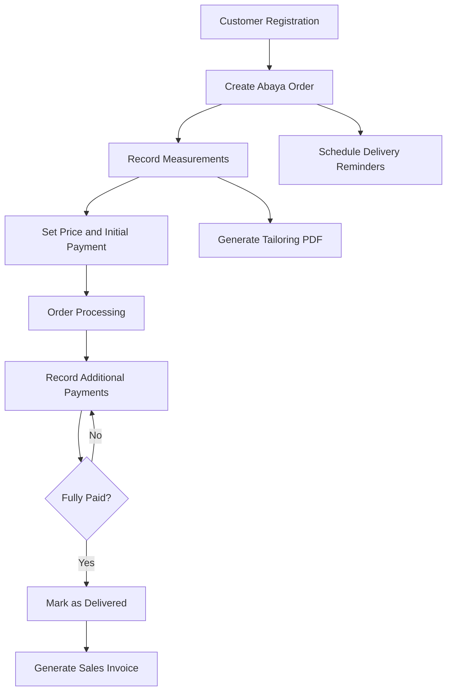

# LAVENT — Abaya Boutique Management System

<p align="center">
  <strong>A Complete Android Business Management Solution for Abaya Boutiques</strong>
</p>

<p align="center">
  
</p>

<p align="center">
  
  
  
  
</p>

---

## Overview

**LAVENT** is a business management application developed with Flutter for an abaya boutique, designed to digitize and streamline its day-to-day operations through a unified Android application.

Built as a **client project**, LAVENT addresses the operational challenges of managing custom abaya orders, customer records, tailoring measurements, payment transactions, delivery schedules, and sales documentation.

Rather than relying on disconnected manual records, the application provides a structured workflow that brings essential business operations into one place, helping the boutique maintain organized order records, monitor financial transactions, and coordinate order fulfillment more efficiently.

The application combines a locally persisted database, reactive state management, automated delivery reminders, and PDF document generation within an Arabic-first user experience designed specifically for the boutique's business requirements.

## Business Objectives

LAVENT was designed around several practical business requirements:

- **Centralized Order Management:** Keep customer information, abaya specifications, measurements, and order statuses organized in one system.
- **Accurate Tailoring Records:** Support both standard and custom measurements, reducing the need for separate handwritten measurement records.
- **Payment Transparency:** Track initial deposits, subsequent payments, receipts, and outstanding balances.
- **Delivery Coordination:** Schedule reminders around expected delivery dates to help prevent missed deadlines.
- **Professional Documentation:** Generate customer invoices and dedicated tailoring sheets as PDF documents.
- **Reliable Local Data Management:** Maintain business records in a structured local database with backup and recovery capabilities.

## Core Features

### 1. Order Management

A complete order management workflow for creating, organizing, searching, and tracking abaya orders.

- Create and update customer orders.
- Automatically generate unique order reference numbers.
- Manage order lifecycle statuses:
  - New
  - Processing
  - Delivered
- Search orders by customer name, phone number, or order reference.
- Filter orders by their current status.
- View detailed order information and associated payment records.
- Record order creation dates and expected delivery dates.
- Track the source through which an order was received, including:
  - WhatsApp
  - Telegram
  - Instagram
  - TikTok
  - Other custom sources
- Archive inactive orders without immediately deleting their records.
- Restore archived orders or permanently remove them.

### 2. Customer & Abaya Information

Each order contains the relevant customer and abaya information required for managing the tailoring process.

**Customer Information**
- Customer name.
- Phone number.
- Address.

**Abaya Information**
- Abaya type.
- Abaya model or reference number.
- Additional order notes.

### 3. Flexible Tailoring Measurement System

One of the key domain-specific features of LAVENT is its support for two different measurement types.

**Standard Measurements**

Allows the user to record a general abaya size, such as size 52.

**Custom Measurements**

Supports detailed individual measurements:

| Measurement | Description |
|---|---|
| Length | Abaya length |
| Shoulder | Shoulder width |
| Sleeve | Sleeve length |
| Chest | Chest measurement |
| Waist | Waist measurement |

Additional measurement notes can be recorded to communicate specific tailoring requirements.

The measurement data is stored with its associated order and can be included in a dedicated PDF document for the tailor.

### 4. Payment & Financial Management

A dedicated payment management workflow that supports initial deposits and subsequent partial payments.

**Initial Payments**
- Record the initial amount paid when an order is created.
- Associate the deposit with its payment method.
- Support cash and electronic wallet payments.

**Additional Payments**
- Register subsequent payments through dedicated receipt records.
- Link each receipt to its corresponding order.
- Generate unique receipt reference numbers.
- Record payment dates, amounts, methods, and notes.
- Support partial payment collection.
- Prevent receipt amounts from exceeding the remaining balance.
- Prevent adding receipts to delivered orders.

**Supported Payment Methods**

- Cash
- Digital Wallets

Available wallet options include Kareemi, Jawali, Jeeb, One Cash, Floosak, Mahfazati, and custom wallet entries.

**Financial Calculations**

The application calculates the total paid amount by combining the initial deposit with all subsequent receipts.

Total Paid:

`Initial Payment + Sum of Additional Receipts`

Remaining Balance:

`Total Order Price - Total Paid`

This provides a clear financial overview for each order.

### 5. PDF Invoice Generation

LAVENT generates professionally formatted sales invoices using the order and its associated payment records.

The invoice includes:

- Boutique branding and logo.
- Customer information.
- Invoice and order reference numbers.
- Invoice date.
- Abaya information.
- Total order price.
- Total amount paid.
- Outstanding balance.
- Breakdown of initial and subsequent payments.
- Payment methods and transaction details.

**Document Operations**
- Preview invoices within the application.
- Generate PDF documents.
- Print invoices.
- Share generated PDF files.

Invoice preview is available for delivered orders with fully settled balances.

### 6. Dedicated Tailoring PDF Documents

In addition to customer invoices, LAVENT provides a separate PDF document specifically for tailoring operations.

This document focuses on production requirements rather than financial information.

It includes:

- LAVENT branding.
- Order reference number.
- Customer name.
- Abaya type and reference number.
- Standard or custom measurements.
- Measurement notes.
- Tailoring instructions.

The generated PDF is saved in the Android Downloads directory under a dedicated `lavent_t` folder and can be shared directly.

This separation allows tailoring information to be communicated independently of customer financial documentation.

### 7. Scheduled Delivery Notifications

A local notification service manages scheduled reminders based on order delivery dates.

For orders with an expected delivery date, the application schedules:

| Reminder | Schedule |
|---|---|
| Early Reminder | Two days before delivery |
| Urgent Reminder | One day before delivery |
| Delivery Day Reminder | 9:00 AM on the scheduled delivery date |

Additional notification management capabilities include:

- Persistent notification history.
- Read and unread notification states.
- Unread notification counters.
- Date-based notification filtering.
- Individual notification deletion.
- Notification history management.
- Cancellation of scheduled reminders when an order is archived.

Notifications are scheduled locally on the Android device without requiring a remote notification server.

### 8. Business Dashboard & Statistics

A centralized dashboard provides a quick overview of the boutique's operational and financial activity.

It includes:

- Active order statistics.
- New order counts.
- Processing order counts.
- Delivered order counts.
- Today's financial collection.
- Overall financial summaries.

The dashboard also provides quick navigation to frequently used operations, including order creation and payment management.

### 9. Receipt Management

A dedicated module for managing payment receipts independently of the order creation workflow.

- Display all recorded receipts.
- Associate each receipt with its corresponding order.
- Show receipt reference numbers.
- Display payment amounts and transaction dates.
- Identify the payment method.
- Navigate to the related order.
- Maintain receipt history and associated notes.

### 10. Order Archiving

A soft-deletion mechanism protects order records from accidental permanent removal.

- Move orders into a separate archive.
- Maintain archived order information in the database.
- Restore archived orders.
- Permanently delete orders when required.
- Automatically remove associated receipt records when an order is permanently deleted through the database's cascading relationship.

### 11. Local Data Backup & Recovery

LAVENT includes data export and restoration tools for maintaining business records.

**Backup**
- Export order and receipt records into structured JSON files.
- Include relevant customer, measurement, payment, and order information.
- Generate timestamped backup files.
- Share backup files through Android's sharing interface.

**Restore**
- Select an existing JSON backup file.
- Import order and receipt records.
- Execute data replacement within a database transaction.

Restoring a backup replaces the current order and receipt data. A separate backup should be created before performing a restoration.

### 12. Authentication & Application Settings

The application provides a local account setup and authentication workflow.

- First-time account setup.
- Username and password login.
- Password hashing using salted SHA-256.
- Credential storage through Flutter Secure Storage.
- Password change functionality.
- Session validation.
- User logout.
- Light and dark appearance modes.

---

## Technical Stack

The application is built using the Flutter ecosystem and selected packages for local persistence, application state, document generation, notifications, and Android file operations.

| Category | Technology | Purpose |
|---|---|---|
| Framework | Flutter | Android application development |
| Language | Dart | Application logic and UI |
| State Management | Riverpod | Reactive application state |
| Database | SQLite | Local data persistence |
| Database ORM | Drift | Type-safe database queries and operations |
| PDF Generation | pdf | Invoice and tailoring document creation |
| PDF Printing | printing | PDF printing and layout operations |
| File Selection | file_picker | Backup file selection |
| File Sharing | share_plus | Sharing PDFs and backup files |
| Notifications | flutter_local_notifications | Scheduled local reminders |
| Timezone Support | timezone | Notification scheduling |
| Secure Storage | flutter_secure_storage | Local credential storage |
| Cryptography | crypto | Password hashing |
| Localization | flutter_localizations | Arabic localization |
| Date & Number Formatting | intl | Localized formatting |
| UI Typography | google_fonts | Application typography |
| Vector Graphics | flutter_svg | SVG asset support |
| Permissions | permission_handler | Permission management |
| File System | path_provider, path | Application directories and file handling |

**Arabic Typography:** Cairo is used for application typography through Google Fonts, while bundled Amiri font files are used for Arabic PDF documents.

## Architecture & Engineering Design

LAVENT follows a modular, layered organization that separates shared application infrastructure, local data management, and presentation components.

The codebase is organized around three primary layers:

**Core Layer**

Contains application-wide infrastructure and shared utilities:
- Application constants.
- Notification service.
- Theme configuration.
- Color palette and text styles.
- Input validation.
- Date and currency formatting.
- ID generation.
- Shared dialogs and toast messages.

**Data Layer**

Responsible for persistent data and local authentication:
- Drift database configuration.
- SQLite table definitions.
- Database queries and CRUD operations.
- Data export and import.
- Authentication service.
- Application enums and data types.

**Presentation Layer**

Contains the user-facing application screens and reusable components:
- Authentication screens.
- Dashboard.
- Order management.
- Archived orders.
- Receipt management.
- Invoice management and preview.
- Notifications.
- Application settings.
- Shared UI components.

### Application Data Flow

```text
        Android Application UI
                  |
                  v
        Presentation Components
                  |
                  v
           Riverpod Providers
                  |
                  v
          AppDatabase (Drift)
                  |
                  v
           SQLite Database
                  |
                  v
          Local Device Storage
```

Supporting services handle authentication, notification scheduling, PDF generation, printing, sharing, and backup operations.

## Project Structure

The following structure highlights the actual Dart application source and its primary Android and asset directories.

```text
lavent_a/
│
├── android/
│   └── app/
│       ├── build.gradle
│       └── src/
│           └── main/
│               ├── AndroidManifest.xml
│               ├── kotlin/
│               │   └── com/example/lavent_a/
│               │       └── MainActivity.kt
│               └── res/
│
├── assets/
│   ├── fonts/
│   │   └── Amiri/
│   │       ├── Amiri-Regular.ttf
│   │       ├── Amiri-Bold.ttf
│   │       ├── Amiri-Italic.ttf
│   │       └── Amiri-BoldItalic.ttf
│   │
│   └── images/
│       ├── app_icon.png
│       └── logol.png
│
├── lib/
│   │
│   ├── core/
│   │   ├── constants/
│   │   │   └── app_constants.dart
│   │   ├── services/
│   │   │   └── notification_service.dart
│   │   ├── theme/
│   │   │   ├── app_colors.dart
│   │   │   ├── app_text_styles.dart
│   │   │   ├── app_theme.dart
│   │   │   └── theme_provider.dart
│   │   └── utils/
│   │       ├── app_toast.dart
│   │       ├── formatters.dart
│   │       ├── id_generator.dart
│   │       └── validators.dart
│   │
│   ├── data/
│   │   ├── local/
│   │   │   ├── auth_service.dart
│   │   │   ├── database.dart
│   │   │   └── database.g.dart
│   │   └── models/
│   │       └── enums.dart
│   │
│   ├── presentation/
│   │   ├── common/
│   │   │   ├── amount_pill.dart
│   │   │   ├── empty_state.dart
│   │   │   ├── lavent_button.dart
│   │   │   ├── lavent_card.dart
│   │   │   ├── lavent_text_field.dart
│   │   │   └── status_badge.dart
│   │   │
│   │   └── screens/
│   │       ├── auth/
│   │       │   ├── login_screen.dart
│   │       │   └── setup_screen.dart
│   │       ├── dashboard/
│   │       │   └── dashboard_screen.dart
│   │       ├── invoices/
│   │       │   ├── invoice_preview_screen.dart
│   │       │   └── invoices_list_screen.dart
│   │       ├── notifications/
│   │       │   └── notifications_screen.dart
│   │       ├── orders/
│   │       │   ├── archived_orders_screen.dart
│   │       │   ├── order_detail_screen.dart
│   │       │   ├── order_form_screen.dart
│   │       │   └── orders_list_screen.dart
│   │       ├── receipts/
│   │       │   ├── receipt_form_screen.dart
│   │       │   └── receipts_list_screen.dart
│   │       └── settings/
│   │           └── settings_screen.dart
│   │
│   ├── providers.dart
│   └── main.dart
│
├── test/
│   └── widget_test.dart
│
├── analysis_options.yaml
├── pubspec.yaml
├── pubspec.lock
└── README.md
```

## Database Design

The application uses SQLite through Drift ORM to maintain structured local business records.

The database consists of three primary tables:

| Table | Description |
|---|---|
| Orders | Stores customer details, abaya specifications, tailoring measurements, dates, status, and financial information |
| Receipts | Stores individual payment transactions linked to their respective orders |
| Notifications | Stores notification content, scheduling information, order references, and read/delivery states |

### Data Relationships

An order can have multiple associated payment receipts.

```text
            Orders
               |
               | 1
               |
               | N
               v
            Receipts
```

The receipt-to-order relationship uses a foreign key with cascading deletion.

Notifications can also reference an associated order.

### Data Management Characteristics

- Auto-incrementing primary keys.
- Unique order and receipt reference fields.
- Persistent local storage.
- Reactive database streams.
- Structured queries for order and payment information.
- Transaction-based data restoration.
- Soft archiving for orders.

## User Interface & Design

LAVENT follows a **Minimal Luxury** design philosophy inspired by the visual identity of premium fashion boutiques.

The interface was designed to provide a consistent and elegant experience while keeping business operations easy to navigate.

### Design Characteristics

- Arabic-first application interface.
- Full right-to-left (RTL) layout.
- Light and dark themes.
- Ivory and warm neutral backgrounds.
- Rose Gold primary accents.
- Champagne Gold secondary accents.
- Carefully structured cards and forms.
- Consistent typography using Cairo.
- Dedicated Amiri typography for Arabic PDF documents.
- Reusable buttons, cards, status indicators, and input components.

## Order Lifecycle

The main business workflow is organized around the following sequence:



## Getting Started

### Requirements

- Flutter SDK.
- Dart SDK 3.5.3 or compatible.
- Android Studio.
- Android SDK and Android build tools.
- Android Emulator or a physical Android device.

### Installation

**1. Clone the repository**

```bash
git clone git@github.com:Mazenalodini/lavent_a.git
```

**2. Navigate to the project directory**

```bash
cd lavent_a
```

**3. Install dependencies**

```bash
flutter pub get
```

**4. Run the application on Android**

```bash
flutter run
```

### Build Release APK

To generate an Android release APK:

```bash
flutter build apk --release
```

The generated APK will be available at:

```text
build/app/outputs/flutter-apk/app-release.apk
```

### Database Code Generation

The project includes Drift-generated database code.

When database table definitions are modified, regenerate the generated files using:

```bash
dart run build_runner build --delete-conflicting-outputs
```

## Platform & Storage

| Property | Details |
|---|---|
| Target Platform | Android |
| Framework | Flutter |
| Database Location | Local device storage |
| Database Technology | SQLite / Drift |
| Backend | No external backend |
| Data Synchronization | No automatic cloud synchronization |
| Notifications | Android local notifications |
| PDF Documents | Generated and managed on the device |

LAVENT uses a local-first approach. Business records are stored on the Android device, while JSON backup files provide a way to export and restore supported business data.

## Project Information

| Attribute | Value |
|---|---|
| Project Name | LAVENT |
| Project Category | Business Management Application |
| Business Domain | Abaya Boutique & Tailoring |
| Project Type | Client Project |
| Development Framework | Flutter |
| Programming Language | Dart |
| Target Platform | Android |
| State Management | Riverpod |
| Database | SQLite with Drift |
| Interface Language | Arabic |
| Layout Direction | RTL |
| Application Version | 1.0.0 |

---


</p>
